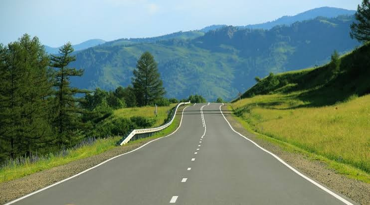
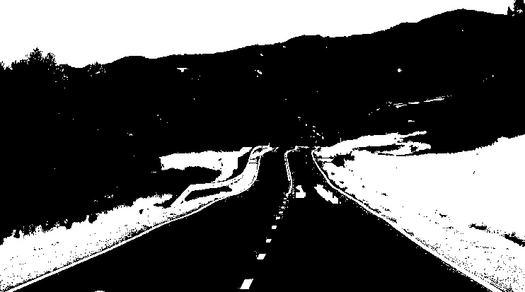
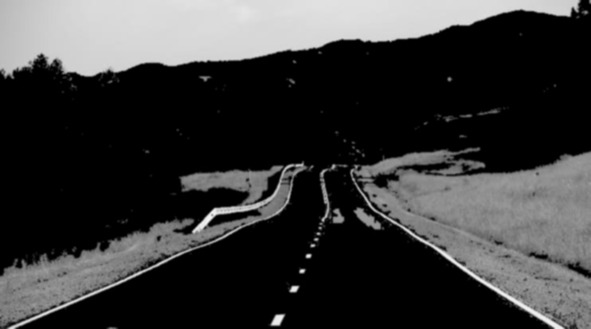
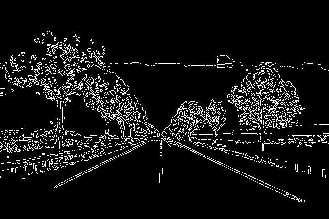
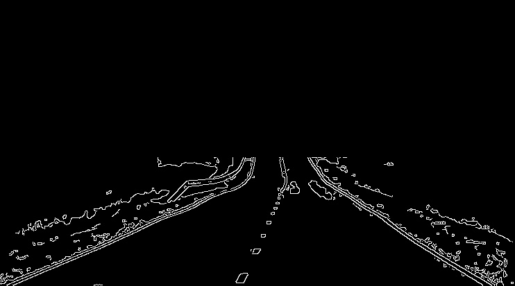

# Lane Line Extractor Using Classical Computer Vision

## 1. Overview

This project implements a lane line extraction system using classical computer vision techniques with OpenCV. It processes static road images to identify potential lane markings by filtering white and yellow colors, detecting edges, and focusing on the road region.

## 2. Technologies Used

- Python
- OpenCV
- NumPy

## 3. Project Structure

```text
LaneLineExtractor/
├── images/
│   ├── image1.jpg
│   ├── image2.jpg
│   ├── image3.jpeg
│   └── image4.jpg
├── outputs/
│   ├── image1/
│   ├── image2/
│   ├── image3/
│   └── image4/
├── lane_detection.py
└── readme.md
```

## 4. Image Processing Steps

### Step 1: Load Image
The input road images are loaded using `cv2.imread()`.

### Step 2: HSV Color Filtering
The image is converted from BGR to HSV color space. Color masks are created to identify white and yellow lane markings. The masks are combined to filter out unwanted colors.

### Step 3: Grayscale Conversion
The filtered image is converted into grayscale to simplify further image processing.

### Step 4: Gaussian Blur
Gaussian blur is applied to reduce noise and small details before edge detection.

### Step 5: Canny Edge Detection
The Canny edge detector identifies edges in the blurred image that may correspond to lane markings.

### Step 6: Region of Interest (ROI)
A polygon-shaped mask is created to focus on the road region and ignore edges outside the selected area.

### Step 7: Final Lane Extraction
The ROI mask is applied to the Canny edge image to retain the detected edges within the region of interest.

## 5. Requirements

Install Python and the required libraries:

```bash
pip install opencv-python numpy
```

## 6. How to Run

1. Clone or download this repository.
2. Ensure the road images are placed inside the `images` folder.
3. Open a terminal in the project directory.
4. Run the Python script:

```bash
python lane_detection.py
```

The program processes the images listed in the script, displays the processing stages, and saves the generated output images in the corresponding folders inside `outputs`.

Ensure the output folders exist before running the program.

## 7. Results

The program generates the following processing outputs for the input road images:

- Original road image
- White and yellow color mask
- Gaussian-blurred image
- Canny edge image
- Region of Interest mask
- Final ROI-masked edge image

The generated images can be viewed in the respective folders inside `outputs`.

### Output Screenshots


**Original Image**



**Color Mask**



**Gaussian Blur**



**Canny Edge Detection**



**ROI Mask**


**Final Lane Extraction**



## 8. Conclusion

This project demonstrates the use of classical computer vision techniques for lane line extraction from static road images. HSV color filtering, Gaussian blur, Canny edge detection, and Region of Interest masking are combined to identify potential lane markings. The results may vary depending on lighting conditions, image quality, color thresholds, and ROI selection.
